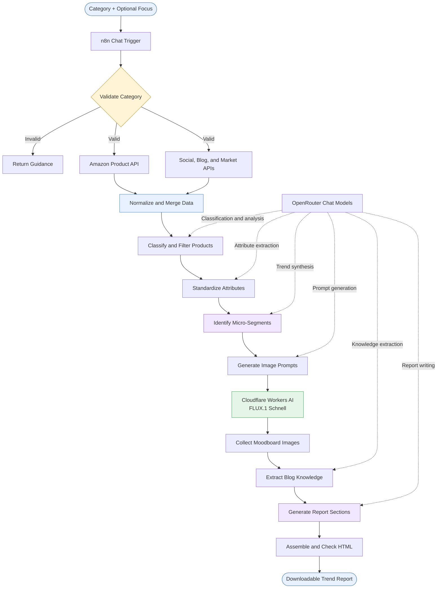
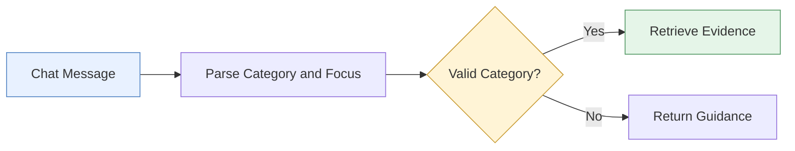

# Consumer Trend Discovery AI Agent — Design Document

Architecture: n8n + OpenRouter Chat Models + External Product and Trend APIs + Cloudflare Workers AI  
Status: Prototype

## 1. System Overview

The Consumer Trend Discovery AI Agent transforms a rug-category request into a structured market intelligence report with trend insights and illustrative moodboards.

The workflow retrieves product listings, social media text signals, blog articles, and market research content. It classifies relevant products, standardizes their attributes, identifies aesthetic micro-segments, generates images, and prepares a downloadable HTML report.

Design objective: Turn fragmented category information into structured insights and visual inspiration through an automated, modular AI workflow.

### High-Level Architecture



## 2. Agent Workflow and Responsibilities

<!-- Paste your full n8n workflow screenshot below. -->
<!-- To embed it, upload the image and insert its image reference here. -->

> Workflow Screenshot  
> Add the complete Consumer Trend Discovery workflow overview here.

<br><br><br><br>

| Stage | Component | Responsibility |
|---|---|---|
| 1 | Chat Trigger and Input Validation | Accepts a category, extracts optional focus, and guides unsupported requests |
| 2A | Amazon Product Retrieval | Retrieves and normalizes product listings |
| 2B | Social and Blog Retrieval | Collects captions, hashtags, articles, market content, and reference images |
| 3 | AI Processing | Classifies products, standardizes attributes, and identifies micro-segments |
| 4 | Moodboard Generation | Creates image prompts and generates illustrative moodboards |
| 5–6 | Knowledge Extraction and Report Writing | Extracts expertise and generates report sections |
| 7 | Output Processing | Assembles HTML, records validation results, and prepares the report file |

## 3. Step-by-Step Workflow

### Step 1 — Receive and Validate the Category

Nodes: `User Enters the Category`, `InputParser1`, `CategoryValidator1`, and `Error Response1`  
Technology: n8n Chat Trigger, Python code, and IF node

Purpose: Start the workflow when the user submits a category through the n8n chat interface.

Input example:

```text
Outdoor Rug, focus: weather-resistant weaves
```

The parser:
1. Reads the incoming chat message.
2. Normalizes capitalization and whitespace.
3. Matches configured category phrases.
4. Extracts optional text following `focus:`.
5. Routes valid requests to retrieval.
6. Returns guidance for greetings or unrecognized categories.

Output:
- `selectedCategory`
- `categoryKey`
- `focus`
- Validation flags and error reason

The advertised categories are Area Rug, Outdoor Rug, Hallway Runner, and Shag Rug. Category matching requires cleanup: ABC Rug is also configured, while the exact singular phrase `shag rug` is absent from the phrase list.



> Screenshot Space  
> Paste the chat trigger, parser, validator, and error-response nodes here.

<br><br><br>

### Step 2 — Retrieve Amazon Product Records

Nodes: `Fetch Amazon Products`, `Has Amazon Products?`, and `Reshape Amazon Response`  
Technology: HTTP request, IF node, and JavaScript

The workflow requests category-specific product records from
