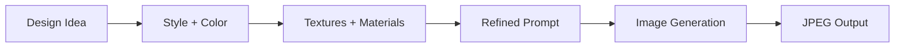
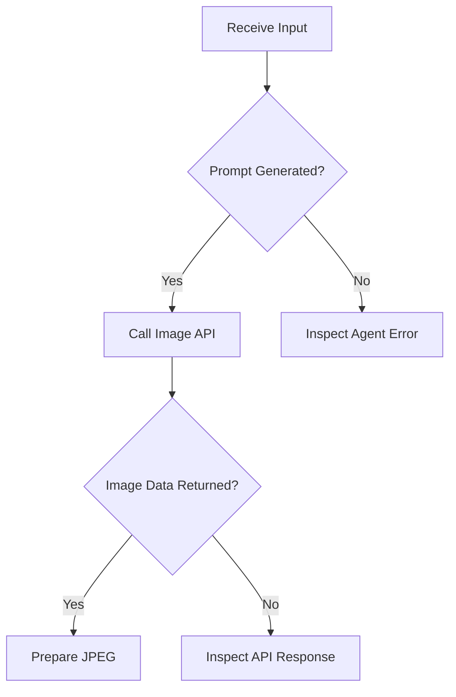

# Moodboard AI Agent — Design Document

**Architecture:** n8n + Google Gemini + Cloudflare Workers AI  
**Status:** Prototype

## 1. System Overview

The Moodboard AI Agent transforms a short interior design idea into a detailed image-generation prompt, then generates a moodboard image using an AI image model.

**Design objective:** Turn creative intent into visual inspiration through an automated, modular AI workflow.

### High-Level Architecture

**[PLACEHOLDER: Insert full n8n workflow screenshot here]**

``

## 2. Agent Workflow and Responsibilities

| Stage | Component | Responsibility |
|---|---|---|
| 1 | Chat Trigger | Accepts a design idea |
| 2 | AI Agent + Gemini | Expands the idea into a descriptive prompt |
| 3 | Clean Prompt | Normalizes prompt text |
| 4 | Cloudflare Workers AI | Generates an image using FLUX.1 Schnell |
| 5 | Output Processing | Extracts Base64 image data and prepares `moodboard.jpg` |

### Prompt-to-Image Data Flow

The agent is instructed to emphasize style, color palettes, textures, styled interiors, and complementary decor. The prompt-cleaning stage joins lines, removes Markdown asterisks, and replaces double quotes with single quotes before sending the prompt downstream.

## 3. Example Input and Output

**Example user input**

> Bohemian rugs, neutral tones

**Expected prompt direction:** A cohesive bohemian interior moodboard featuring neutral colors, layered textiles, natural materials, rug textures, and complementary decor.

**[PLACEHOLDER: Insert your generated moodboard image here]**

``

*Use an actual workflow output for the portfolio demonstration; the description above illustrates intended behavior, not a measured result.*

## 4. Reliability and Evaluation

The AI Agent is configured for up to three retries with a five-second wait. This does not guarantee recovery from downstream API or file-processing errors. End-to-end testing is required.

| Evaluation metric | What to measure |
|---|---|
| Workflow success rate | Requests that produce a valid image |
| Prompt relevance | Alignment with the user's original idea |
| Visual alignment | Match to requested styles, colors, and materials |
| Generation time | Time from input to image output |

*Baseline measurements and success targets are not yet established.*

## 5. Security and Next Steps

**Security:** Keep API credentials in n8n credentials or a secrets manager. Remove secrets from exported workflow JSON and rotate any token that has already been exposed.

**Next iteration priorities**

1. Validate successful image generation and JPEG delivery.
2. Add input validation and clearer error handling.
3. Test varied design prompts and evaluate visual relevance.
4. Explore style presets and multiple image variations.

**[PLACEHOLDER: Add a small evaluation chart here after testing]**

Suggested chart: workflow success rate across test prompts, or prompt relevance ratings. Add real measured data rather than estimated results.

## Summary

The prototype demonstrates an end-to-end pipeline combining conversational input, LLM-based prompt refinement, and AI image generation. Its modular design provides a foundation for evaluating how automated prompt engineering can support early-stage interior design exploration.
