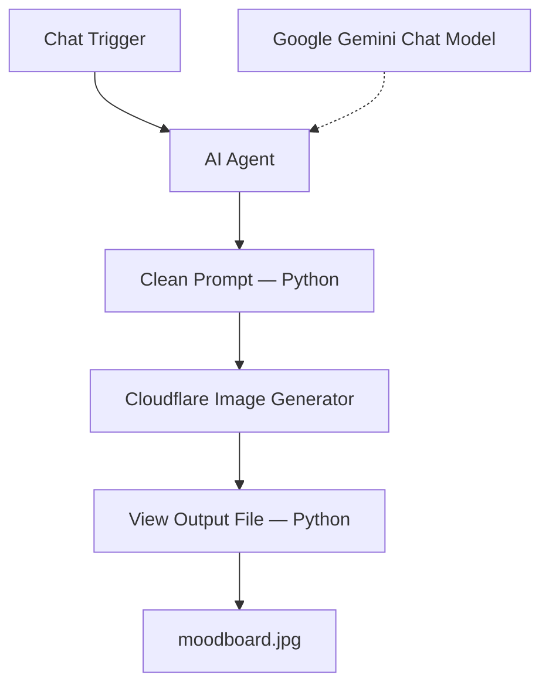

# Moodboard AI Agent — Agent Design Document

## 1. Overview

The Moodboard AI Agent is an n8n workflow that transforms a simple interior-design idea into a generated moodboard image.

The workflow accepts a user's idea through a chat interface, uses Google Gemini to expand it into a detailed image-generation prompt, cleans the prompt with Python, sends it to Cloudflare Workers AI using FLUX.1-schnell, and packages the returned Base64 image as a downloadable file named `moodboard.jpg`.

**Key technologies**
- **Workflow orchestration:** n8n
- **Prompt generation:** Google Gemini Chat Model
- **Image generation:** Cloudflare Workers AI — FLUX.1-schnell
- **Text processing:** Python Native Code nodes
- **User input:** n8n Chat Trigger
- **Output:** `moodboard.jpg`

## 2. Problem Statement

People may have a clear idea for a home-decor style but lack the vocabulary or experience to write a detailed image-generation prompt.

For example, a user may enter `White Rug` without specifying textures, materials, color variations, interior styling, or visual composition.

The agent aims to bridge this gap by converting a short idea into a more descriptive prompt and generating a visual starting point.

*This is a product hypothesis, not a validated user-research finding.*

## 3. Goals and Non-Goals

### Goals
- Accept a design idea through chat.
- Generate a detailed image-generation prompt using an AI Agent.
- Clean the generated prompt before sending it to an external API.
- Generate an image through Cloudflare Workers AI.
- Convert the response into an n8n binary image output.
- Use `moodboard.jpg` as the output filename.

### Non-Goals
- Product catalog search or live inventory information.
- Product recommendations with verified prices or purchase links.
- Saved user accounts or moodboard history.
- Multi-image editing or iterative refinement.
- Automated image-quality scoring.
- Production-scale monitoring or analytics.

These capabilities are not implemented in the supplied workflow.

## 4. System Architecture



### Workflow sequence

1. The user submits an idea through the chat trigger.
2. The AI Agent uses Google Gemini to generate a detailed image prompt.
3. The Clean Prompt node removes selected formatting characters and line breaks.
4. The HTTP Request node sends the prompt to Cloudflare's FLUX image-generation endpoint.
5. The View Output File node extracts the Base64 image payload and packages it as binary output.

## 5. Node Design

### 5.1 When Chat Message Received

**Node type:** `@n8n/n8n-nodes-langchain.chatTrigger`

**Purpose:** Starts the workflow when a user submits a message.

**Example input:**
```text
White Rug
```

The supplied configuration uses default options and passes the incoming chat data to the AI Agent.

### 5.2 AI Agent

**Node type:** `@n8n/n8n-nodes-langchain.agent`

**Purpose:** Acts as an image-generation prompt engineer.

The system instructions direct the agent to:
- Identify the style, colors, and textures implied by the idea.
- Include close-up material textures.
- Describe styled interior spaces and complementary decor.
- Organize visuals into an inspiration-ready collection.
- Produce a prompt suitable for an image generator.

**Reliability configuration:**
- Retry on failure: enabled
- Maximum tries: 3
- Wait between tries: 5,000 milliseconds

The downstream Clean Prompt node reads the agent's `output` field.

### 5.3 Google Gemini Chat Model

**Node type:** `@n8n/n8n-nodes-langchain.lmChatGoogleGemini`

**Purpose:** Provides the language model used by the AI Agent.

The node connects to the AI Agent through n8n's language-model connection. The supplied JSON does not specify a model name or custom generation parameters, so those details are not assumed here.

### 5.4 Clean Prompt

**Node type:** `n8n-nodes-base.code`

**Language:** Python Native

**Purpose:** Cleans the generated prompt before the image-generation request.

The code:
1. Reads the AI Agent's `output` field.
2. Replaces line breaks with spaces.
3. Removes `**` and `*` characters.
4. Replaces double quotation marks with single quotation marks.
5. Returns the cleaned prompt under the `prompt` key.

Simplified version of the supplied logic:

```python
input_prompt = _items[0]["json"].get("output", "") or ""

clean_prompt = " ".join(input_prompt.splitlines())
clean_prompt = clean_prompt.replace("**", "").replace("*", "")
clean_prompt = clean_prompt.replace('"', "'")

return [{"json": {"prompt": clean_prompt}}]
```

**Limitation:** This is basic text cleanup, not comprehensive input validation or security sanitization. The node reads the first input item, which fits the expected single-prompt workflow.

### 5.5 Cloudflare Image Generator

**Node type:** `n8n-nodes-base.httpRequest`

**Purpose:** Sends the cleaned prompt to the image-generation model.

**HTTP method:** `POST`

**Model endpoint path:**
`@cf/black-forest-labs/flux-1-schnell`

**Request settings:**
- Authorization: Bearer token
- Content type: JSON
- Prompt length: truncated to a maximum of 2,000 characters in the request expression
- Steps: `4`
- Full response: enabled

The request body is configured to send the cleaned prompt and the `steps` value.

**Security requirement:** Store the Cloudflare token in n8n credentials or a secure secret-management mechanism. Never publish a real token in workflow JSON or GitHub. If a token has already been exposed, revoke or rotate it.

**Implementation consideration:** Test special characters such as quotes, backslashes, and Unicode characters in user prompts. Use safe structured JSON expression handling to avoid malformed request bodies.

### 5.6 View Output File

**Node type:** `n8n-nodes-base.code`

**Language:** Python Native

**Purpose:** Extracts the generated image and constructs an n8n binary output.

The code:
1. Checks the response for `result` at the root level or under `body`.
2. Reads the image from `result.image`.
3. Raises an error if the image payload is missing.
4. Constructs an output item with file metadata and binary data.

**Output metadata:**
- Filename: `moodboard.jpg`
- MIME type: `image/jpeg`

**Limitation:** The node assumes the API returns a Base64 image string in `result.image`. The binary-data structure should be tested against the installed n8n version, and the final file should be opened to verify that it is a valid image.

## 6. Data Flow

| Stage | Input | Output |
|---|---|---|
| Chat Trigger | User's design idea | Chat data |
| AI Agent + Gemini | Chat data | Detailed prompt in `output` |
| Clean Prompt | Generated prompt | Cleaned text in `prompt` |
| Cloudflare Image Generator | Prompt and generation settings | API response containing image data |
| View Output File | API response | Binary image output |
| Final result | Binary image | `moodboard.jpg` |

## 7. Prompt Design

The system message focuses on five qualities:

- **Style:** Capture the aesthetic implied by the user's idea.
- **Color:** Describe the relevant palette.
- **Texture:** Include material and surface details.
- **Context:** Incorporate styled interiors and complementary decor.
- **Composition:** Create a coherent, inspiration-ready collection.

### Example

**User input**
```text
White Rug
```

**Illustrative generated prompt**
```text
Create a polished interior-design moodboard centered on premium white and ivory rugs. Include a range of complementary neutral interiors, tactile rug close-ups, material details, and coordinated decor. Explore aesthetics such as Nordic minimalism, bohemian texture, modern luxury, and organic natural materials. Use a cohesive neutral palette, thoughtful editorial composition, and clear visual groupings suitable for design inspiration.
```

This is an illustrative example, not a recorded output from a particular workflow execution.

## 8. Error Handling and Failure Modes

| Failure mode | Current behavior | Recommended improvement |
|---|---|---|
| AI Agent call fails | Retry configured up to 3 tries | Verify behavior in execution logs |
| Empty AI output | Clean Prompt substitutes an empty string | Validate prompt and return a helpful error |
| Special characters in prompt | Basic cleanup and truncation | Test safe JSON serialization |
| Cloudflare request fails | No explicit recovery branch is shown | Add error handling and a clear failure response |
| Image payload is missing | Python node raises `ValueError` | Return a safe diagnostic without exposing secrets |
| Binary image is invalid | File metadata is constructed | Verify n8n binary format and test image opening |
| Poor visual result | No automatic quality check is shown | Review sample outputs manually |

The current behavior above is based on the supplied JSON; improvements are recommendations rather than implemented features.

## 9. Evaluation Plan

The supplied workflow does not include automated evaluation or measured results. The following checks can be performed manually.

### Functional tests
- Submit a design idea through chat.
- Confirm the AI Agent returns a non-empty prompt.
- Confirm Clean Prompt produces the `prompt` field.
- Confirm the Cloudflare request succeeds.
- Confirm the response contains image data.
- Confirm the final output opens as a valid image named `moodboard.jpg`.

### Prompt-quality checks
Review whether the prompt:
- Matches the original user idea.
- Describes a relevant style and color palette.
- Includes useful material and texture details.
- Mentions interior context and complementary decor.
- Provides clear composition guidance.
- Avoids unnecessary formatting or commentary.

### Suggested test inputs

| Test input | What to inspect |
|---|---|
| `White Rug` | Whether the prompt adds useful design detail |
| `Bohemian rugs, neutral tones` | Whether the bohemian style and neutral palette are represented |
| `Minimalist dark green living room` | Whether the specific palette and room style are retained |
| Empty input | Whether missing intent is handled clearly |
| Long design description | Whether truncation preserves important details |

Do not claim quality scores, success rates, latency, cost savings, or user impact without collected evidence.

## 10. Security and Privacy

- Rotate any Cloudflare token exposed in a workflow export or public repository.
- Store secrets in n8n credentials or an approved secret manager.
- Remove tokens and environment-specific details before publishing workflow JSON.
- Validate user input before sending requests to external services.
- Avoid logging secrets or unnecessarily retaining user prompts.
- Disclose third-party model processing when appropriate for the workflow's audience.

## 11. Known Limitations

Based on the supplied workflow:
- A multi-image generation strategy is not defined.
- Product catalog and shopping integrations are not present.
- Persistent image storage or moodboard history is not configured.
- The AI Agent does not have a defined structured output schema.
- Prompt cleanup is basic and does not fully validate input.
- A dedicated HTTP error-handling branch is not shown.
- Automated visual-quality evaluation is not implemented.
- The final binary-data structure needs verification in the target n8n version.
- Gemini model parameters are not specified in the JSON.

## 12. Future Improvements

1. Add input validation for empty or overly long messages.
2. Use robust structured JSON construction for API requests.
3. Define a predictable output format for the AI Agent.
4. Validate Cloudflare responses before constructing binary output.
5. Add explicit error handling for model, API, and file-conversion failures.
6. Create a repeatable set of prompts for manual evaluation.
7. Allow users to refine the moodboard through follow-up instructions.
8. Move all secrets out of exported workflow JSON.
9. Add optional storage so users can revisit generated moodboards.

## 13. Definition of Done

- [ ] A user can submit a design idea through the chat trigger.
- [ ] The AI Agent returns a relevant, detailed prompt.
- [ ] Clean Prompt returns a non-empty `prompt` field.
- [ ] The Cloudflare endpoint returns an image response.
- [ ] The final node outputs a valid, viewable image.
- [ ] The output filename is `moodboard.jpg`.
- [ ] Failure cases are tested.
- [ ] No live API token or secret is included in the public repository.

## 14. Conclusion

This project demonstrates an end-to-end generative AI workflow connecting conversational input, LLM-based prompt enrichment, lightweight Python processing, external image generation, and binary file packaging.

Its main strength is integrating these steps into one repeatable n8n workflow. The next priorities are securing credentials, improving request construction, verifying binary output, and testing successful and failed executions.

---

**Implementation reference:** This document is based on the n8n workflow JSON provided for the Moodboard AI Agent. Verify runtime behavior in n8n before describing the workflow as production-ready.
