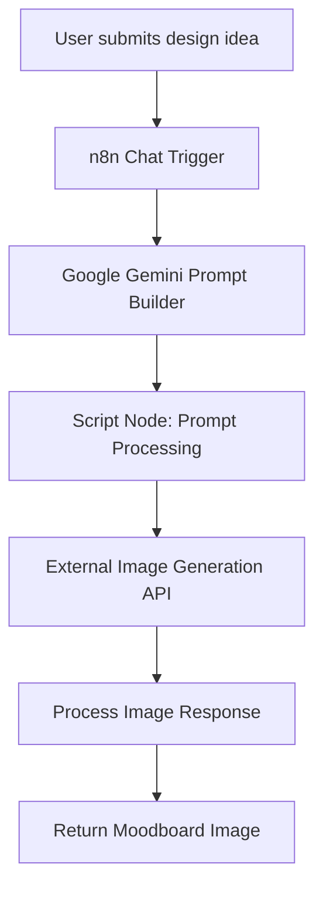

# 🧠 AI Agent Design Document
## Lab 01 — Workflow Automation & AI Moodboard Design

> **Project:** Moodboard Generator AI Agent  
> **Category:** Generative AI · Workflow Automation · Prompt Engineering  
> **Orchestration:** n8n  
> **Language model:** Google Gemini  
> **Prompt processing:** Custom script node  
> **Image generation:** External image-generation API  
> **Status:** Prototype

---

## 1. Executive Summary

The Moodboard Generator AI Agent explores how a generative AI workflow can transform a short design idea into a structured image-generation prompt and, ultimately, a visual moodboard.

The prototype was developed incrementally across four phases:

1. **Environment validation** — verify basic workflow execution.
2. **Conditional orchestration** — route execution based on input conditions.
3. **Context-aware prompt engineering** — transform a short keyword into a detailed creative brief.
4. **End-to-end image generation** — connect prompt generation, script-based processing, and an external image-generation service.

The central design idea is to separate **creative reasoning, workflow control, prompt processing, and image generation** into distinct stages. This makes the workflow easier to understand, test, and improve.

## 2. Problem & Design Motivation

### The problem

A short design request often does not contain enough detail to guide image generation toward a specific visual outcome.

For example:

`White Rug`

This input identifies the subject but leaves important creative decisions unspecified:

- Design aesthetic
- Material and texture
- Interior setting
- Lighting and composition
- Visual organization of the final moodboard

### Design hypothesis

An AI agent can enrich a short user request with structured visual details before passing it to an image-generation service.

The intended workflow is:

**Simple idea → Detailed creative brief → Processed prompt → Generated moodboard**

This is a product hypothesis explored through a technical prototype, not a validated claim about customer outcomes.

---

## 3. Agent Objectives

The agent design focuses on five objectives:

| Objective | Design intention |
|---|---|
| Understand input | Accept a short design request through a chat interface. |
| Enrich intent | Use Google Gemini to generate a detailed visual prompt. |
| Prepare the prompt | Process the generated text before sending it to another service. |
| Generate imagery | Pass the processed prompt to an image-generation API. |
| Return an artifact | Process the response and make the resulting image available. |

The prototype also explores different prompt structures to understand how an AI model can generate either a focused aesthetic or a collection of distinct styles.

---

## 4. High-Level Architecture

### System architecture



### Component responsibilities

| Component | Responsibility | Design consideration |
|---|---|---|
| Chat Trigger | Receives the user's design request. | Preserve the original user intent. |
| Google Gemini | Expands the request into a detailed visual brief. | Include relevant style, material, texture, and composition details. |
| Script node | Processes and sanitizes the generated prompt. | Ensure the text conforms to the downstream API's expected input format. |
| Image-generation API | Generates imagery from the processed prompt. | Handle API response formats and generation failures. |
| Response-processing stage | Extracts or processes the generated image response. | Ensure the resulting image can be returned to the user. |
| Output stage | Makes the moodboard available as an artifact. | Verify the output format and download behavior. |

*The table describes the intended responsibilities of the workflow components. Error handling, validation, and output checks should be documented as implemented only after verification.*

---

## 5. Design Principles

### 5.1 Separate orchestration from generation

n8n manages the sequence of operations and connections between components. The language model handles prompt generation, while the image-generation service produces the visual output.

This separation makes it easier to identify which stage needs improvement when a result is incorrect.

### 5.2 Enrich the user's intent rather than replace it

The prompt-generation stage should elaborate on the user's request without losing its central subject.

For example, the input `White Rug` should remain focused on white rugs even when the model introduces additional details about texture, setting, or aesthetics.

### 5.3 Keep downstream inputs predictable

The prompt-processing stage exists to prepare generated text for the next API call.

The goal is to avoid formatting incompatibilities and ensure the downstream service receives the expected prompt value.

The exact sanitization rules should be documented alongside the script implementation.

### 5.4 Experiment before adding complexity

The lab began with a basic workflow and gradually introduced branching, AI-generated prompts, and image generation.

This approach helps isolate workflow issues before adding more components.

---

## 6. Agent Workflow: Four Development Phases

### Phase 1 — Environment Handshake

**Purpose:** Validate the n8n environment and basic workflow execution.

**Workflow**

```text
Manual Trigger → Code Node → JSON Response
```

The Code node returned:

```json
{
  "message": "Hello World!"
}
```

**Why this phase matters**

A minimal workflow provides a baseline for verifying trigger behavior, node execution, and output structure before introducing external services.

**Portfolio evidence**

- [Workflow Interface](LINK_TO_WORKFLOW_SCREENSHOT)
- [Raw Workflow JSON](LINK_TO_WORKFLOW_JSON)

**Design outcome:** Established a simple execution path to build on.

### Phase 2 — Logic-Driven Branching

**Purpose:** Explore conditional execution and routing.

**Workflow concept**

```text
Timed Trigger → Input Data → IF Condition
                              ├── Match → Custom Layout
                              └── No Match → Backup Path
```

A sample variable such as `weather: "sunny"` was used to explore how an IF condition could determine the next execution path.

**Design rationale**

Not every input should follow the same path. Conditional logic provides a mechanism for routing tasks according to the data available.

**Portfolio evidence**

- [Workflow Interface](LINK_TO_BRANCHING_SCREENSHOT)
- [Raw Workflow JSON](LINK_TO_BRANCHING_JSON)

**Design outcome:** Explored conditional routing and the concept of a fallback execution path.

*This was a workflow-logic experiment, not a claim that weather-based routing is part of the final moodboard agent.*

### Phase 3 — Context-Aware Prompt Engineering

**Purpose:** Transform a short user input into a detailed creative brief.

**Workflow**

```text
Chat Input → AI Agent Instructions → Google Gemini → Expanded Prompt
```

The input `White Rug` was used to explore two prompt-generation strategies.

#### Experiment A — Single-aesthetic concept

**Input:** `White Rug`

**Intended output:** A focused interior design moodboard prompt emphasizing premium white and ivory rugs, high-end textures, and minimalist lifestyle imagery.

**Design approach**

This strategy develops one cohesive visual direction. The prompt can elaborate on the subject through material details, texture, and lifestyle composition.

**Evaluation question**

Does a short input become a richer creative brief while retaining a consistent aesthetic?

**Evidence**

- [Generated Output](LINK_TO_SINGLE_STYLE_OUTPUT)
- [Model Input and Output](LINK_TO_SINGLE_STYLE_LOGS)

#### Experiment B — Multi-style matrix

**Input:** `White Rug`

**Intended output:** A moodboard concept titled *The White Rug Collection*, organized around five distinct aesthetics.

| Style | Visual direction |
|---|---|
| Nordic Minimalist | Raw wool and understated simplicity |
| Boho Chic | Shag texture and fringe |
| Modern Opulence | Silk-inspired textures and marble surroundings |
| Organic Earthy | Cotton braids and natural materials |
| Architectural Linear | Geometric forms and dimensional shadows |

**Design approach**

Rather than producing one cohesive aesthetic, this prompt explicitly defines multiple visual categories.

The structure encourages the model to treat each category as a distinct part of the composition, reducing the risk of blending incompatible design directions.

**Evaluation question**

Can explicit grouping and style constraints produce a more organized multi-style concept than a general prompt?

**Evidence**

- [Generated Output](LINK_TO_MULTI_STYLE_OUTPUT)
- [Model Input and Output](LINK_TO_MULTI_STYLE_LOGS)

**Design outcome:** Explored the trade-off between a single cohesive aesthetic and a multi-style exploration framework.

---

### Phase 4 — End-to-End Moodboard Agent

**Purpose:** Connect prompt generation to image generation and return a final visual artifact.

**Workflow**

```text
Chat Trigger
     ↓
Gemini Prompt Builder
     ↓
Script-Based Prompt Processing
     ↓
Image-Generation API
     ↓
Image Response Processing
     ↓
Downloadable Moodboard
```

**Key design decision**

The prompt-processing stage separates language-model output from the input expected by the image-generation API.

This is important because generated text may contain formatting or additional structure that does not match the downstream service's input requirements.

**Expected output**

A generated image returned as a downloadable `moodboard.jpg`.

**Evidence**

- [Workflow Blueprint](LINK_TO_FINAL_WORKFLOW)
- [Execution Logs](LINK_TO_EXECUTION_LOGS)
- [Generated Moodboard](LINK_TO_FINAL_MOODBOARD)

**Implementation detail to verify:** Earlier lab notes describe Python-based prompt processing, while the current phase notes describe a JavaScript sanitizer and mention Hugging Face FLUX. Confirm the actual script language and configured image-generation provider before publishing these as final implementation details.

---

## 7. Prompt Design Strategy

The prompt-generation stage is responsible for converting a short request into a richer description suitable for image generation.

### Proposed prompt structure

A structured creative brief can be organized around these dimensions:

| Dimension | Purpose | Example |
|---|---|---|
| Subject | Preserve the user's main idea. | White rug |
| Aesthetic | Define the visual style. | Nordic Minimalist |
| Material | Describe the surface or construction. | Raw wool |
| Texture | Add tactile visual detail. | Soft, textured fibers |
| Setting | Establish the surrounding environment. | Bright, minimal living room |
| Composition | Describe the arrangement. | Product close-up and wider interior view |
| Mood | Set the visual atmosphere. | Calm, understated, premium |

This table is a design framework for describing the prompt. It should not be interpreted as a confirmed output schema unless the implementation explicitly uses these fields.

### Two prompt strategies

| Strategy | Strength | Trade-off |
|---|---|---|
| Single-aesthetic prompt | Supports a more cohesive visual direction. | Explores fewer alternatives in one generation. |
| Multi-style prompt | Supports broader creative exploration. | Requires clear grouping and composition constraints. |

The appropriate strategy depends on whether the user wants a focused visual concept or inspiration across multiple aesthetics.

---

## 8. Input, Processing & Output Contracts

Defining component contracts makes the workflow easier to test and maintain.

| Stage | Input | Expected output |
|---|---|---|
| Chat Trigger | User's design request | Captured input text |
| Gemini Prompt Builder | Original design request | Expanded image-generation prompt |
| Prompt Processor | Generated prompt | Processed prompt text |
| Image-Generation API | Processed prompt | Image-generation response |
| Response Processor | API response | Image artifact or image data |
| Output Stage | Processed image | Downloadable moodboard |

These are the intended data contracts. Exact n8n node fields and API response schemas should be added after inspecting the actual workflow configuration.

---

## 9. Failure Modes & Design Considerations

The following are risks to address or verify during testing.

| Potential failure | Design consideration |
|---|---|
| Empty or unclear user input | Validate input before prompt generation. |
| Prompt loses the original subject | Check that the expanded prompt preserves the core intent. |
| Generated prompt contains unwanted formatting | Normalize the prompt before passing it downstream. |
| Image-generation API returns an error | Add appropriate error handling and user feedback. |
| API response has an unexpected format | Validate the response before image processing. |
| Image artifact is unavailable | Confirm the output is accessible before returning it. |
| Multi-style output mixes categories | Strengthen grouping, layout, and style constraints in the prompt. |

These are design considerations, not assertions that each failure has already been encountered or that mitigation is already implemented.

---

## 10. Evaluation Plan

The next stage is to evaluate both workflow correctness and output quality.

### Workflow validation

- Does each stage receive the expected input?
- Does the workflow complete an end-to-end run?
- Is the image-generation response processed correctly?
- Can the user access the final moodboard?
- What happens when a service fails?

### Prompt and image evaluation

- Does the prompt preserve the original design idea?
- Does the generated concept follow the intended aesthetic?
- Are the visual details relevant to the request?
- Are different styles clearly distinguishable in the multi-style experiment?
- Is the generated moodboard useful as a starting point for creative exploration?

### Suggested test set

| Test case | Input | Focus |
|---|---|---|
| Basic | `White Rug` | Prompt expansion |
| Style-specific | `Minimalist ivory rug` | Style adherence |
| Material-specific | `Natural wool rug` | Material and texture |
| Ambiguous | `Something cozy` | Interpretation of vague intent |
| Empty input | Empty string | Input validation |
| API failure | Simulated service error | Failure handling |

Record actual observations and results after running these tests. Do not report quality scores, reliability percentages, latency, or cost without measurement.

---

## 11. Future Improvements

The following improvements are potential next steps rather than confirmed capabilities.

**Prompt quality**
- Standardize the prompt structure.
- Compare single-style and multi-style outputs using the same evaluation rubric.
- Test whether additional constraints improve visual consistency.

**Workflow reliability**
- Validate input and API response formats.
- Improve failure handling and error messages.
- Verify image artifact integrity before returning it.

**User experience**
- Explore a user-facing style selector.
- Allow users to refine their creative direction.
- Investigate whether users prefer one cohesive moodboard or several alternative styles.

**Product validation**
- Test the prototype with representative users.
- Collect qualitative feedback about output usefulness.
- Establish baseline metrics before defining performance targets.

---

## 12. Implementation Status

| Capability | Status based on lab notes |
|---|---|
| Basic n8n workflow validation | Attempted and documented |
| Conditional branching experiment | Explored |
| Gemini prompt-generation experiment | Explored |
| Single-aesthetic prompt variant | Explored |
| Multi-style prompt variant | Explored |
| End-to-end image-generation workflow | Described as assembled; verify with a successful run |
| Downloadable moodboard output | Intended output; include evidence of a successful download |
| Formal evaluation results | Not yet documented |
| User research and outcome validation | Proposed |

Update this table as you verify each capability and add links to the supporting evidence.

---

## 13. Conclusion

Lab 01 explores the design of a generative AI agent through incremental workflow development.

The project progresses from validating basic automation to experimenting with conditional routing, designing structured prompts, and connecting language-model output to image generation.

The main design insight is the value of separating **workflow orchestration, prompt generation, prompt processing, and image generation** into identifiable stages.

This separation provides a practical foundation for debugging, evaluating, and improving the agent as the prototype evolves.

---

## 🔗 Related Artifacts

- [Product Requirements Document](./PRD.md)
- [Workflow Screenshot](LINK_TO_WORKFLOW_SCREENSHOT)
- [Workflow JSON](LINK_TO_WORKFLOW_JSON)
- [Prompt Experiment Outputs](LINK_TO_PROMPT_EXAMPLES)
- [Final Moodboard](LINK_TO_MOODBOARD_IMAGE)

