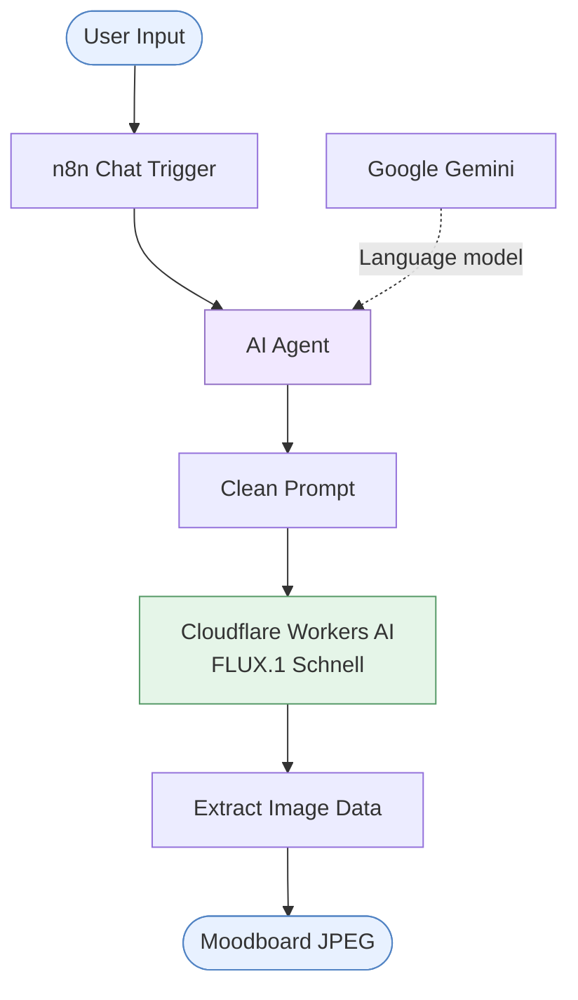
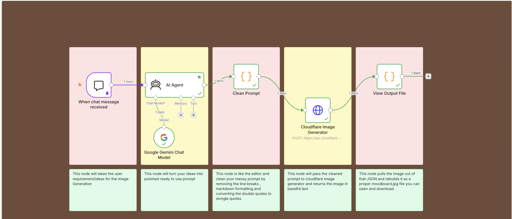

# Moodboard AI Agent — Design Document

**Architecture:** n8n + Google Gemini + Cloudflare Workers AI  
**Status:** Prototype

## 1. System Overview

The Moodboard AI Agent transforms a short interior design idea into a detailed image-generation prompt, then generates a moodboard image using an AI image model.

**Design objective:** Turn creative intent into visual inspiration through an automated, modular AI workflow.

### High-Level Architecture

## 2. Agent Workflow and Responsibilities

 

| Stage | Component | Responsibility |
|---|---|---|
| 1 | Chat Trigger | Accepts a design idea |
| 2 | AI Agent + Gemini | Expands the idea into a descriptive prompt |
| 3 | Clean Prompt | Cleans prompt text |
| 4 | Cloudflare Workers AI | Asks Cloudflare Image Generator to generate the image |
| 5 | Output Processing | Extracts Base64 image data and prepares `moodboard.jpg`  |

## 3. Step-by-Step Workflow

### Step 1 — Receive the Design Idea

**Node:** `When chat message received`  
**Purpose:** Starts the workflow when the user submits a message through the n8n chat interface.

**Input example:** `Bohemian rugs, neutral tones`, white color rug

**Output:** The user's message becomes the input for the AI Agent.

### Step 2 — Interpret and Expand the Idea

**Node:** `AI Agent`  
**Model:** Google Gemini Chat Model

The AI Agent acts as an image-generation prompt engineer. It takes the user's short description and expands it into a more detailed visual concept.

Its instructions emphasize:
- Interior design style and atmosphere.
- Color palettes and material textures.
- Close-up material details and styled interior spaces.
- Complementary decor and visual consistency.

**Input:** The original design idea.  
**Output:** A detailed, image-ready text prompt.

The agent is configured to retry up to three times, waiting five seconds between retries. These settings do not guarantee that every failure will be recovered.

### Step 3 — Clean the Generated Prompt

**Node:** `Clean Prompt`  
**Technology:** Python code node

The generated prompt may contain line breaks or Markdown formatting. This node prepares the text for the image-generation request by:
1. Reading the agent's `output` field.
2. Joining multiple lines into a single line.
3. Removing Markdown asterisks.
4. Replacing double quotes with single quotes.

**Input:** The AI Agent's text output.  
**Output:** A cleaned prompt stored in the `prompt` field.

This is text normalization, not a semantic quality check; it does not verify that the prompt accurately reflects the user's intent.

### Step 4 — Generate the Moodboard Image

**Node:** `Cloudflare Image Generator`  
**Service:** Cloudflare Workers AI  
**Model:** `@cf/black-forest-labs/flux-1-schnell`

This node sends an HTTP POST request to the image-generation API. The request includes the cleaned prompt, limited to 2,000 characters, and a generation setting of four steps.

The API processes the prompt and returns a response containing image data when successful.

**Input:** The cleaned prompt and generation parameters.  
**Output:** The API response, which is passed to the next node.

### Step 5 — Extract and Prepare the Image

**Node:** `View Output File`  
**Technology:** Python code node

The final node searches for image data in the response's `result.image` field or the nested `body.result.image` field.

It then prepares an output item containing:
- **Filename:** `moodboard.jpg`
- **MIME type:** `image/jpeg`
- **Image data:** The returned Base64 string in the configured binary output field.

This node pulls the image out of that JSON and rebuilds it as a proper moodboard.jpg file you can open and download.

## Summary

This workflow demonstrates an end-to-end AI pipeline: capturing a design idea, refining it with a language model, normalizing the prompt, generating an image, and preparing the output file. Each node has a distinct responsibility, making the prototype easier to test, debug, and extend.
